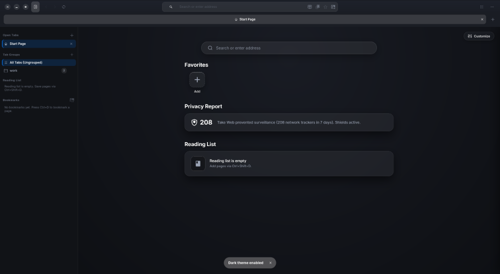
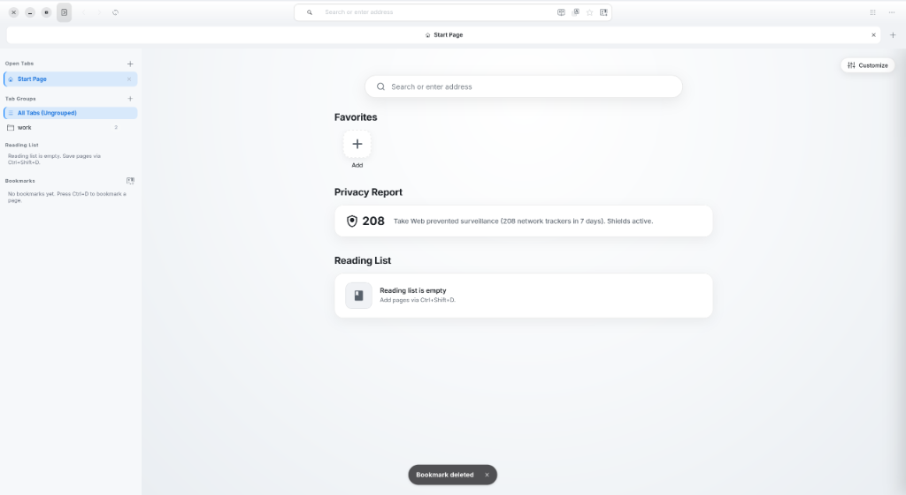
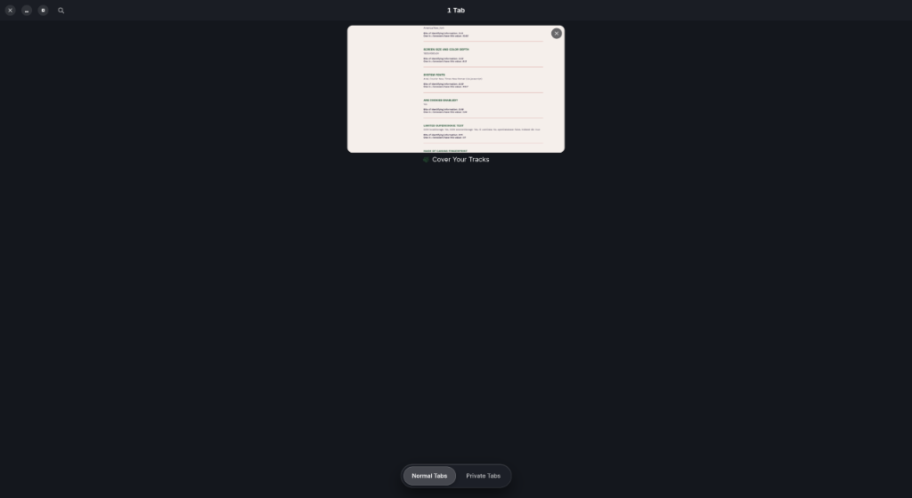
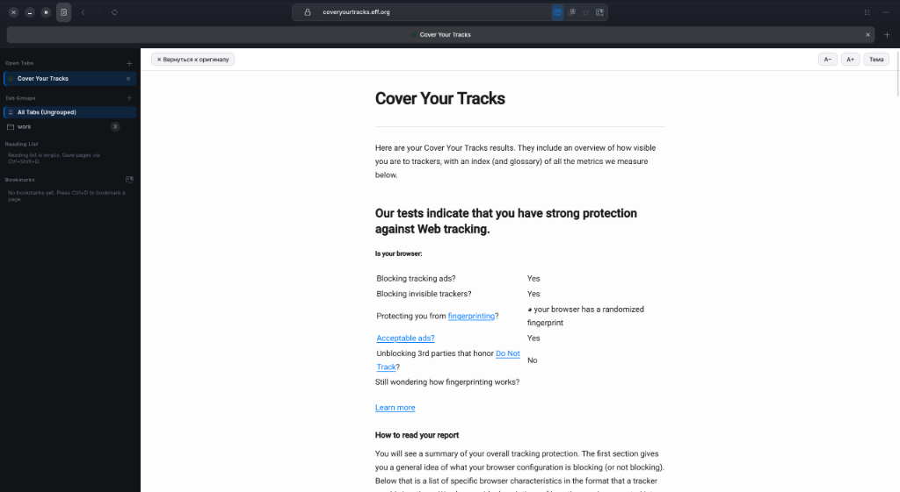
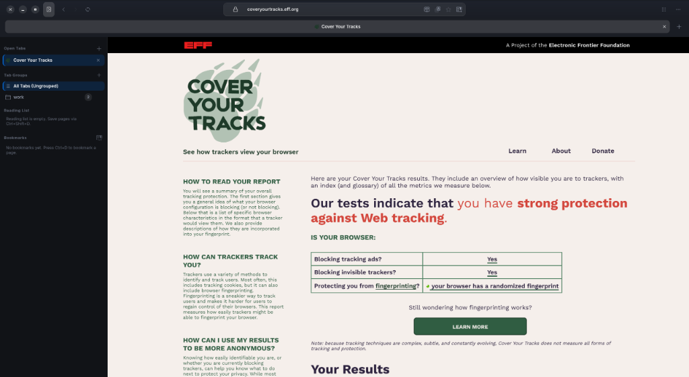

<div align="center">


# TakeWeb

A lightweight Linux browser built with GTK4, Libadwaita, and WebKitGTK. Vertical tabs, engine-level tracker blocking, and offline translations.

[](https://github.com/dezaetterg/take-web/releases)
[](LICENSE)
[](https://github.com/dezaetterg/take-web/actions)

**English** | [Русский](README.ru.md)



</div>

## Why I Built It

I wanted a browser that could handle a dozen tabs on my desktop PC without chewing through all available RAM, and without phoning home to remote telemetry endpoints. Chrome and Firefox are heavy, and existing WebKit browsers for Linux are either unmaintained or lacking essential daily-driver features. TakeWeb fits my specific workflow: GNOME on Wayland, vertical tabs, and minimal trust in websites.

Status: Beta. I use it as my daily driver, but it has not been tested widely across different hardware combinations yet. Expect edge cases and report any bugs you find via issues.

| Light theme | Dark theme |
| :---: | :---: |
|  |  |

## Features

**Tabs and Window Management**
- Vertical sidebar with collapsible tab groups, reading list, and bookmarks.
- Split View (`F3` or `Ctrl+\`): view two sites side-by-side with separate navigation controls.
- Tab Overview (`Ctrl+Shift+E`): visual overview grid of normal and private tabs.
- Reader Mode (`F9`): stripped of images, ads, and tracking scripts, with dark and light theme styles.
- Web App Mode: `takeweb --app=<URL>` opens sites in standalone windows without address bars and generates desktop shortcuts.
- Media controls via MPRIS (system tray and media keys).

| Tab Overview (`Ctrl+Shift+E`) | Reader Mode (`F9`) |
| :---: | :---: |
|  |  |

**Privacy and Security**
- Ad and tracker blocking via native WebKit content filtering rules (`WebKitUserContentFilter`). Filtering runs before page parsing, without needing third-party extensions. The Take Shield popover displays blocked trackers for the current site.
- Built-in anti-fingerprinting: Canvas and WebGL buffer noise, coarsened `performance.now()`, masked media device enumeration, and protected system fonts.
- Automatic query parameter stripping: removes `utm_*`, `fbclid`, `gclid`, `gbraid`, `wbraid`, `yclid`, `ymclid`, `mc_eid`, and `_openstat` when navigating or copying links.
- Third-party cookies disabled by default. Private windows run with an ephemeral in-memory context: cookies and cache discard on close.
- Language synchronization: HTTP `Accept-Language`, `navigator.languages`, and search engine query parameters match your configured UI language.
- Zero telemetry. The only network connections made by the browser itself are on-demand translation model downloads when requested by the user.

**Offline Translations**
- Page and selected text translations run completely offline using Mozilla Bergamot (WASM). No text is ever sent to external translation APIs. Language models download on demand into `~/.local/share/takeweb/models/bergamot/`.

**Memory Management**
- Inactive background tabs suspend after 30 seconds (or 10 seconds if more than 4 tabs are open, or when available system memory drops below 15%). Suspending drops decoded image and font glyph caches, triggers JavaScript garbage collection, and pauses media. When switching back, tabs resume immediately without reloading over the network.
- WebKit `MemoryPressure` thresholds adapt to total physical RAM at startup (see [ARCHITECTURE.md](ARCHITECTURE.md)).
- Disk cache is capped at 500 MB with automatic LRU eviction.

**Storage and Customization**
- Bookmarks and history stored in SQLite with WAL mode, FTS5 full-text search directly from the address bar, and asynchronous writes off the UI thread.
- Custom URLs for the start page and default search engine (use `%s` for search query interpolation).
- UI and internal pages (`take://start`, `take://settings`, `take://trackers`) localized in English and Russian. English is the default fallback. Community translation guide: [CONTRIBUTING_TRANSLATIONS.md](CONTRIBUTING_TRANSLATIONS.md).

## Privacy Verification

Tested using EFF's [Cover Your Tracks](https://coveryourtracks.eff.org): blocking tracking ads and invisible trackers, with randomized fingerprint protection. Note that this is a single online test suite, not a formal security certification or independent audit.

<p align="center">
  
</p>

For storage details and cookie isolation mechanisms, see Section 5 of [ARCHITECTURE.md](ARCHITECTURE.md). In short: user profile data is saved under `~/.local/share/takeweb/`, completely isolated from the source repository, and excluded in `.gitignore`.

## Requirements

- Linux x86_64.
- **Wayland session.** On systems with GNOME + Wayland + NVIDIA proprietary drivers, the browser routes its GTK surface through XWayland (`GDK_BACKEND=x11`). This works around an upstream Mutter/WebKitGTK fence sync bug that otherwise throttles frame rates to ~20 FPS. TakeWeb is optimized for Wayland; running in pure X11 environments is known to have poor rendering performance.
- GTK 4.12+, Libadwaita 1.5+, WebKitGTK 6.0 (2.52+), SQLite 3.40+, GStreamer 1.22+ (plugins good, bad, ugly, and libav for video decoding).
- Build requirements: Rust 1.92+ and header files for the libraries above.
- Bubblewrap (`bwrap`) for the sandboxed WebProcess.

## Installation

Prebuilt `.deb`, `AppImage`, and `tar.gz` packages are available on the [Releases](https://github.com/dezaetterg/take-web/releases) page.

```bash
# Debian / Ubuntu / Linux Mint / Pop!_OS
sudo apt install ./takeweb_0.1.0_amd64.deb

# Any Linux distribution (AppImage)
chmod +x TakeWeb-0.1.0-x86_64.AppImage && ./TakeWeb-0.1.0-x86_64.AppImage
```

From source (no root required):

```bash
git clone https://github.com/dezaetterg/take-web.git
cd take-web
./install.sh
```

`install.sh` builds the release binary, places it in `~/.local/bin/takeweb`, and installs icons and desktop entries under `~/.local/share/`. To uninstall, run `./uninstall.sh` (or `./uninstall.sh --purge` to also delete user data and cache).

Packages can be built with `scripts/build_dist.sh` after running `cargo build --release`. Generated artifacts in `dist/` include `.deb`, AppImage, portable tarball, Arch `PKGBUILD`, and RPM spec.

## Architecture

TakeWeb runs across three separate process tiers: the native GTK4 UI process, the WebKit network process (caching, content filters, TLS), and the isolated WebProcess running inside a Bubblewrap sandbox. Internal `take://` scheme handlers authenticate via a cryptographic session token so external web pages cannot spoof internal interfaces. Detailed specifications, diagrams, and benchmarks are in [ARCHITECTURE.md](ARCHITECTURE.md).

## Memory Benchmarks

Measurements were recorded on a single reference PC: AMD Ryzen 5 5600, NVIDIA GeForce RTX 4060 (proprietary driver), GNOME on Wayland. Memory usage on different hardware and driver configurations will vary. Values represent total PSS and RSS across all browser processes. Benchmark scripts are not yet packaged, so treat these figures as reference data points.

| Scenario | TakeWeb (PSS / RSS) | Chrome 130 | Firefox 132 |
| :--- | :--- | :--- | :--- |
| Startup, start page | 393 / 867 MB | 534 / 1593 MB | 460 / 1120 MB |
| 1 active tab (Wikipedia Linux article) | 587 / 1074 MB | 637 / 1836 MB | 610 / 1340 MB |
| 5 active tabs | 820 / 1480 MB | 1420 / 2890 MB | 1150 / 2210 MB |
| Same 5 tabs after 30 seconds idle (suspended) | 480 / 1110 MB | 1380 / 2810 MB | 1080 / 2150 MB |
| 10 tabs in session, inactive tabs suspended | 610 / 1390 MB | 2240 / 4120 MB | 1790 / 3340 MB |

## Environment Variables

These variables are intended for performance tuning and graphics diagnostics.

| Variable | Values | Description |
| :--- | :--- | :--- |
| `TAKEWEB_GFX_TUNING` | `1` (default), `0` | Set `0` to disable automatic graphics driver workarounds |
| `TAKEWEB_GDK_BACKEND` | `x11`, `wayland` | Force a specific GDK display backend |
| `TAKEWEB_GSK_RENDERER` | `gl`, `vulkan`, `cairo` | Select the GTK4 scene renderer |
| `TAKEWEB_WEBKIT_DMABUF` | `on`, `off` | Set `off` to disable hardware DMA-BUF texture sharing |
| `TAKEWEB_NVIDIA` | `1`, `0` | Override automatic NVIDIA GPU detection |
| `TAKEWEB_GPU_VENDOR` | `0x10de`, `0x8086`, `0x1002` | Manually specify GPU vendor ID (NVIDIA, Intel, AMD) |
| `TAKEWEB_VAAPI_VENDOR` | `0x8086`, `0x1002` | Specify GPU vendor for hardware video decoding (VA-API) |

## Development

```bash
cargo run --release
cargo fmt --check && cargo clippy --all-targets -- -D warnings && cargo test
```

Unit tests verify URL resolution, tracker classifications, cookie policies, and i18n parity between `en.json` and `ru.json`. The GitHub Actions CI runs these same checks.

## License

Licensed under GPL-3.0-or-later. Full text in [LICENSE](LICENSE). Author: [@dezaetterg](https://github.com/dezaetterg).
