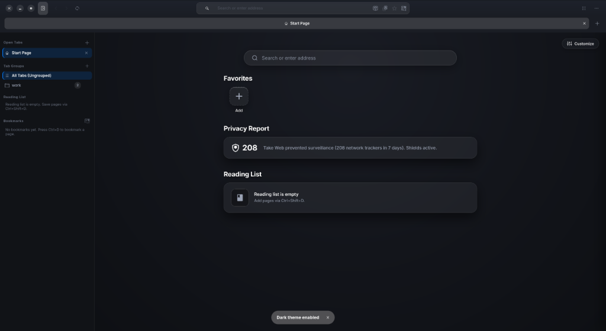
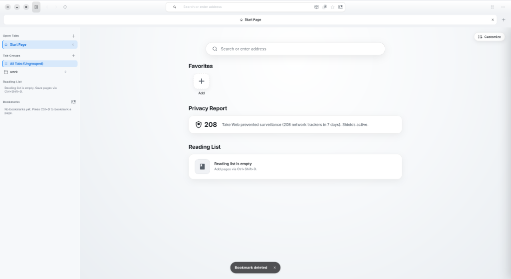
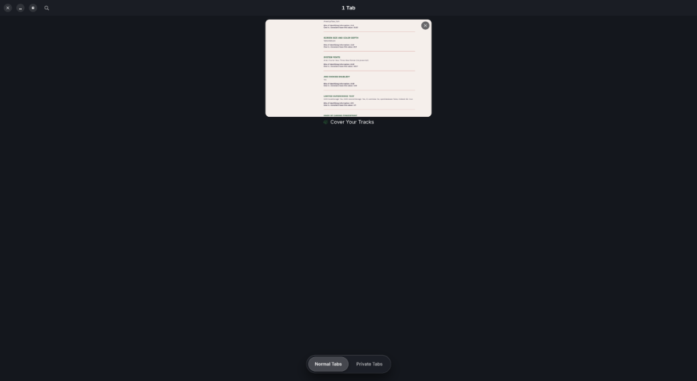
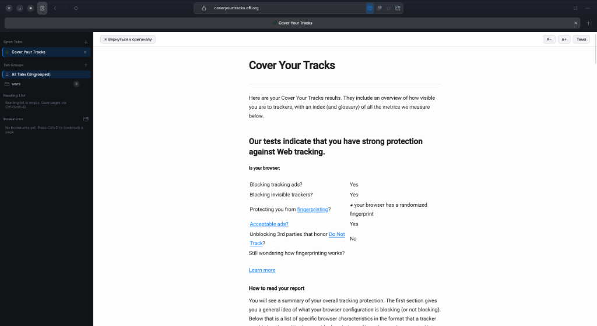
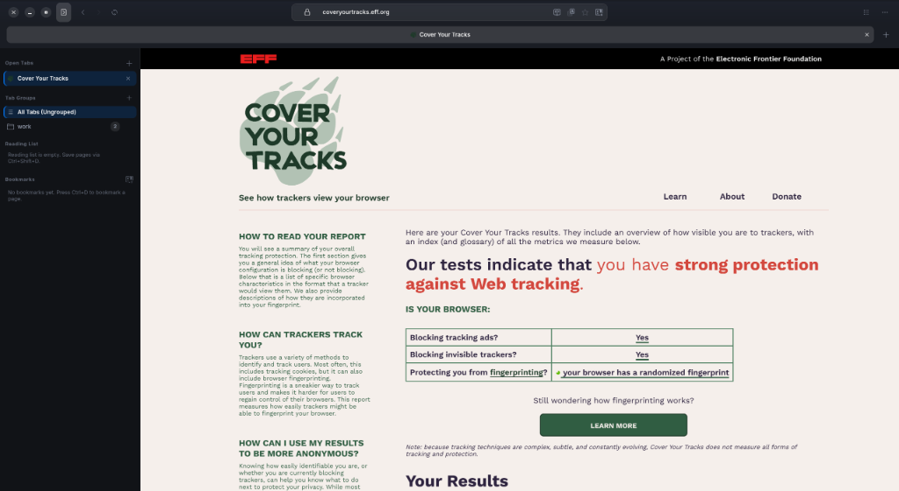

<div align="center">


# TakeWeb

Браузер для Linux на GTK4, Libadwaita и WebKitGTK. Вертикальные вкладки, блокировка трекеров на уровне движка, перевод страниц без облака.

[](https://github.com/dezaetterg/take-web/releases)
[](LICENSE)
[](https://github.com/dezaetterg/take-web/actions)

[English](README.md) | **Русский**



</div>

## Зачем он нужен

Я хотел браузер, который на моём ПК держит десяток вкладок и не съедает всю память, и при этом не шлёт ничего на чужие серверы. Chrome и Firefox это не умеют, а другие WebKit-браузеры для Linux либо заброшены, либо не доведены до повседневного использования. TakeWeb сделан под мой сценарий: GNOME на Wayland, много вкладок, мало доверия к сайтам.

Статус: бета. Я пользуюсь им каждый день, но на других конфигурациях железа его почти не гонял, так что баги будут. Присылайте issues.

| Светлая тема | Тёмная тема |
| :---: | :---: |
|  |  |

## Что внутри

**Вкладки и окна**
- Вертикальная боковая панель с группами вкладок, списком для чтения и закладками.
- Split View (`F3` или `Ctrl+\`): два сайта рядом.
- Обзор вкладок (`Ctrl+Shift+E`): наглядная сетка открытых обычных и приватных вкладок.
- Режим чтения (`F9`) без картинок и рекламы, с тёмной и светлой темой.
- Режим приложения: `takeweb --app=<URL>` открывает сайт в окне без адресной строки и создаёт ярлык `.desktop`.
- Медиаклавиши и управление плеером через MPRIS.

| Обзор вкладок (`Ctrl+Shift+E`) | Режим чтения (`F9`) |
| :---: | :---: |
|  |  |

**Приватность**
- Блокировка рекламы и трекеров правилами `WebKitUserContentFilter`. Фильтрация идёт до парсинга страницы, расширения не нужны. В окне Take Shield видно, какие трекеры заблокированы на текущем сайте.
- Скрипт против фингерпринтинга: шум в Canvas и WebGL, огрублённый `performance.now()`, скрытый список аудиоустройств, защита от перебора шрифтов.
- Из ссылок вырезаются `utm_*`, `fbclid`, `gclid`, `gbraid`, `wbraid`, `yclid`, `ymclid`, `mc_eid` и `_openstat`, в том числе при копировании адреса.
- Сторонние cookie отключены. Приватные окна используют эфемерное хранилище: cookie и кеш живут только в памяти.
- Язык сайтов следует за языком браузера: заголовок `Accept-Language`, `navigator.languages` и языковые параметры поисковиков берутся из одной настройки.
- Встроенной телеметрии нет.

**Перевод**
- Страницы и выделенный текст переводятся локально движком Mozilla Bergamot (WASM). Текст никуда не отправляется. Модели скачиваются по запросу в `~/.local/share/takeweb/models/bergamot/`.

**Память**
- Фоновая вкладка засыпает через 30 секунд, а если вкладок больше четырёх или свободной памяти меньше 15%, через 10. При засыпании сбрасывается кеш изображений и глифов, запускается сборка мусора JavaScript, медиа ставится на паузу. При возврате на вкладку страница не перезагружается.
- Лимиты `MemoryPressure` WebKit подбираются по объёму RAM при старте. Таблица в [ARCHITECTURE.ru.md](ARCHITECTURE.ru.md).
- Дисковый кеш ограничен 500 МБ и чистится по LRU.

**Прочее**
- История и закладки в SQLite (WAL), полнотекстовый поиск FTS5 прямо из адресной строки, запись в отдельном потоке.
- Свой URL для стартовой страницы и для поисковой системы (`%s` подставляется как запрос).
- Интерфейс и внутренние страницы (`take://start`, `take://settings`, `take://trackers`) на английском и русском. Язык по умолчанию английский, русский включается при `ru_RU`. Как добавить свой язык, написано в [CONTRIBUTING_TRANSLATIONS.md](CONTRIBUTING_TRANSLATIONS.md).

## Приватность на практике

Я прогнал браузер через [Cover Your Tracks](https://coveryourtracks.eff.org) от EFF. Результат: блокируется реклама и скрытые трекеры, отпечаток рандомизирован. Это один тест, а не сертификация, и он не заменяет аудит.

<p align="center">
  
</p>

Где что хранится, и что происходит с cookie, описано в разделе 5 [ARCHITECTURE.ru.md](ARCHITECTURE.ru.md). Коротко: профиль лежит в `~/.local/share/takeweb/`, в каталог проекта ничего не пишется, а базы и сессии исключены в `.gitignore`.

## Требования

- Linux x86_64.
- **Wayland.** На GNOME + Wayland + проприетарный драйвер NVIDIA браузер сам запускает GTK через XWayland (`GDK_BACKEND=x11`). Без этого обмен буферами между WebKitGTK и Mutter упирается в ~20 FPS. Это обход конкретной проблемы, а не поддержка X11. В чистой сессии X11 TakeWeb работает плохо, и пока я не знаю почему.
- GTK 4.12+, Libadwaita 1.5+, WebKitGTK 6.0 (2.52+), SQLite 3.40+, GStreamer 1.22+ с plugins-good, bad, ugly и libav для видео.
- Для сборки: Rust 1.92+ (требование gtk4-rs) и заголовки перечисленных библиотек.
- Песочница веб-процесса использует `bwrap`, поставьте Bubblewrap.

## Установка

Готовые `.deb`, `AppImage` и `tar.gz` лежат на странице [Releases](https://github.com/dezaetterg/take-web/releases).

```bash
# Debian, Ubuntu
sudo apt install ./takeweb_0.1.0_amd64.deb

# любой дистрибутив
chmod +x TakeWeb-0.1.0-x86_64.AppImage && ./TakeWeb-0.1.0-x86_64.AppImage
```

Из исходников, без root:

```bash
git clone https://github.com/dezaetterg/take-web.git
cd take-web
./install.sh
```

Скрипт собирает релизный бинарник, кладёт его в `~/.local/bin/takeweb`, ставит иконки и `.desktop`-файл в `~/.local/share/`. Удаление: `./uninstall.sh`, а с флагом `--purge` ещё и профиль с кешем.

Пакеты собираются скриптом `scripts/build_dist.sh` после `cargo build --release`. В `dist/` попадают `.deb`, AppImage, tar.gz, `PKGBUILD` для Arch и spec для RPM.

## Как это устроено

Три процесса: интерфейс на GTK4, сетевой процесс WebKit (сеть, HTTP-кеш, фильтр трекеров) и процесс веб-содержимого в песочнице Bubblewrap. Страницы `take://` защищены сессионным токеном, чтобы обычный сайт не мог подделать служебную страницу. Подробности, схемы и расчёты: [ARCHITECTURE.ru.md](ARCHITECTURE.ru.md).

## Замеры памяти

Все цифры сняты на одном ПК: Ryzen 5 5600, RTX 4060 с проприетарным драйвером, GNOME на Wayland. На другом железе результат будет другим. Считалась сумма PSS и RSS по всему дереву процессов браузера. Скрипты замеров пока не опубликованы, так что проверить цифры нельзя, относитесь к ним как к ориентиру.

| Сценарий | TakeWeb (PSS / RSS) | Chrome 130 | Firefox 132 |
| :--- | :--- | :--- | :--- |
| Старт, стартовая страница | 393 / 867 МБ | 534 / 1593 МБ | 460 / 1120 МБ |
| 1 вкладка, статья Linux в Wikipedia | 587 / 1074 МБ | 637 / 1836 МБ | 610 / 1340 МБ |
| 5 активных вкладок | 820 / 1480 МБ | 1420 / 2890 МБ | 1150 / 2210 МБ |
| Те же 5 вкладок после 30 с простоя | 480 / 1110 МБ | 1380 / 2810 МБ | 1080 / 2150 МБ |
| 10 вкладок, неактивные выгружены | 610 / 1390 МБ | 2240 / 4120 МБ | 1790 / 3340 МБ |

## Переменные окружения

Нужны в основном для отладки графики.

| Переменная | Значения | Что делает |
| :--- | :--- | :--- |
| `TAKEWEB_GFX_TUNING` | `1` (по умолчанию), `0` | `0` отключает автоподбор графических настроек |
| `TAKEWEB_GDK_BACKEND` | `x11`, `wayland` | принудительно выбирает бэкенд GDK |
| `TAKEWEB_GSK_RENDERER` | `gl`, `vulkan`, `cairo` | выбирает рендерер GTK4 |
| `TAKEWEB_WEBKIT_DMABUF` | `on`, `off` | `off` отключает DMA-BUF |
| `TAKEWEB_NVIDIA` | `1`, `0` | вручную включает или выключает режим для NVIDIA |
| `TAKEWEB_GPU_VENDOR` | `0x10de`, `0x8086`, `0x1002` | вендор GPU (NVIDIA, Intel, AMD) |
| `TAKEWEB_VAAPI_VENDOR` | `0x8086`, `0x1002` | вендор GPU для декодирования видео через VA-API |

## Разработка

```bash
cargo run --release
cargo fmt --check && cargo clippy --all-targets -- -D warnings && cargo test
```

Тесты проверяют в том числе то, что в `ru.json` есть все ключи из `en.json`. CI запускает те же три команды.

## Лицензия

GPL-3.0-or-later, текст в [LICENSE](LICENSE). Автор: [@dezaetterg](https://github.com/dezaetterg).
